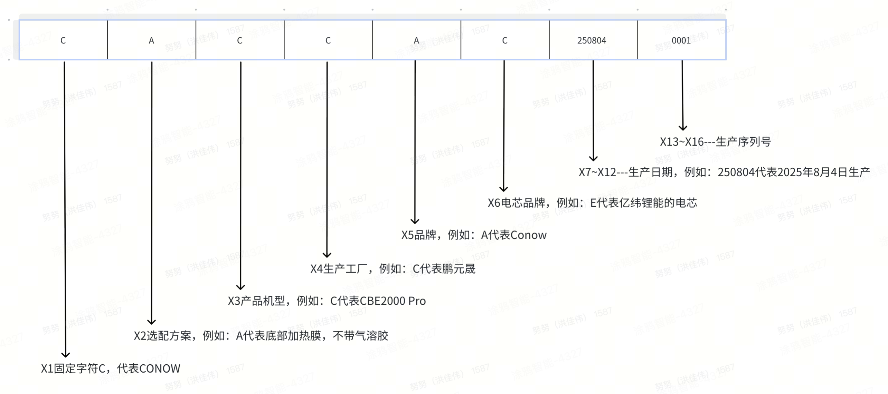

# 涂鸦储能产品整机SN编码规则

| 文件名称： | 涂鸦储能产品整机SN编码规则 |
|-|-|
| 文件编码： |  |
| 编制部门： | 硬件开发部 |
| 适用范围： | 涂鸦智能自研或共研的储能产品 |
| 拟 稿 人： | 史振邦 |
| 秘密等级： | □  绝密          □  机密        ■  秘密          □  一般  |

文件发行/修订履历

| 版本号 | 日 期 | 修改内容 | 拟 稿 | 审 核 | 批 准 |
|-|-|-|-|-|-|
| V1.0 | 2025/8/28 | 初版发行 | 史振邦 |  |  |
| V2.0 | 2025/11/5 | 1.新增产品机型代码F&G---详见表3；   2.新建新增客户代码G---详见表5；   3.新增电芯代码C&R&G---详见表6； | 史振邦 |  |  |
| V3.0 | 2025/11/21 | 1.产品G更名为“Lyra2500 AC”---详见表3；   2.新增产品H、I、J---详见表3； | 史振邦 |  |  |
| V4.0 | 2026/1/21 | 1.更改X2代码含义---详见5.2.2   2.更新7附件-示例 | 史振邦 |  |  |
| V5.0 | 2026/3/2 | 1.新增电芯代码Y---详见表6； | 史振邦 |  |  |
| V6.0 | 2026/4/14 | 1.新增产品机型---详见表3；   2.新增工厂代码F---详见表4；   3.新增电芯代码D---详见表6；   4.取消品牌代码X的含义； | 史振邦 |  |  |
| V7.0 | 2026/6/26 | 1.新增产品机型---详见表3； | 史振邦 |  |  |
|  |  |  |  |  |  |
|  |  |  |  |  |  |

| 章节号 | 内     容 | 页  次 |
|-|-|-|
| 1 | 目的 | 2 |
| 2 | 适用范围 | 2 |
| 3 | 参考文件 | 2 |
| 4 | 定义 | 2 |
| 5 | 编码规则 | 2-4 |
| 6 | 附则 | 5 |
| 7 | 附件 | 5 |

1. 目的

规范产品命名与编码规则，并用于追溯。

1. 适用范围 

涂鸦智能自研或共研的储能产品。

1. 参考文件 

无

1. 定义

    无

1. 编码规则 

5.1整机SN的16位代码定义及其编码规则

                             表1   整机SN的16位代码编码规则  

| 代码 | 定义 | 编码规则 |
|-|-|-|
| X1 | 固定码 |  |
| X2 | 选配方案 | 见下表2 |
| X3 | 产品机型 | 见下表3 |
| X4 | 生产工厂代码 | 见下表4 |
| X5 | 品牌代码 | 见下表5 |
| X6 | 电芯品牌代码 | 见下表6 |
| X7-X8 | 年 | 见5.2.6 |
| X9-X10 | 月 | 见5.2.7 |
| X10-X11 | 日 | 见5.2.8 |
| X13-X16 | 流水号 | 系统自动生成 |

5.2各字段具体定义

      5.2.1  X1编码固定字符“C”，代表“CONOW”。

5.2.2  X2编码：

表2   X2位选配方案

| 字符 | 含义 |
|-|-|
| A | 底部加热膜，不带气溶胶 |
| B | 侧边加热膜，不带气溶胶 |
| C | 底部加热膜，带气溶胶 |
| D | 侧边加热膜，带气溶胶 |
| E | 不带加热膜，不带气溶胶 |
| F | 不带加热膜，带气溶胶 |

5.2.3  X3编码

表3  X3位产品机型代码

<table><colgroup><col/><col/><col/></colgroup><tbody><tr><td colspan="2">产品机型代码</td><td>备注</td></tr><tr><td>CBE2000</td><td>A</td><td>阳台储能一体机</td></tr><tr><td>CBE2000S</td><td>B</td><td>阳台储能一体机</td></tr><tr><td>CBE2000 Pro</td><td>C</td><td>阳台储能一体机</td></tr><tr><td>CBE2000 AC</td><td>D</td><td>阳台储能一体机</td></tr><tr><td>CBE Expansion Battery 2000</td><td>E</td><td>阳台储能扩容电池包</td></tr><tr><td>CBE Expansion Battery 5000</td><td>F</td><td>阳台储能扩容电池包</td></tr><tr><td>Lyra2500 AC</td><td>G</td><td>阳台储能一体机</td></tr><tr><td>Lyra2500 Pro</td><td>H</td><td>阳台储能一体机</td></tr><tr><td>CBE5000 Pro</td><td>I</td><td>阳台储能一体机</td></tr><tr><td>Atlas6000 AC</td><td>J</td><td>阳台储能一体机</td></tr><tr><td>Nova Air EC SP</td><td>K</td><td>户储单相低压一体机机头</td></tr><tr><td>Nova Air Battery 5000</td><td>L</td><td>户储单相低压一体机电池模块</td></tr><tr><td>Nova Apex EC SP</td><td>M</td><td>户储单相高压一体机机头</td></tr><tr><td>Nova Apex EC TP</td><td>N</td><td>户储三相高压一体机机头</td></tr><tr><td>Nova Apex Battery 6000</td><td>P</td><td>户储三相高压一体机电池模块</td></tr><tr><td>Nova Apex Battery 8000</td><td>Q</td><td>户储三相高压一体机电池模块</td></tr><tr><td>PowerSync</td><td>R</td><td>并机盒</td></tr></tbody></table>

5.2.4  X4编码

表4：X4位生产工厂代码

| 字符 | 生产工厂 |
|-|-|
| A | 天宝 |
| B | 豪鹏 |
| C | 鹏元晟 |
| D | 鹏威 |
| E | 九联 |
| F | 海鹏科技 |
| G | ... |

     5.2.5  X5编码

表5：X5位品牌代码

| 字符 | 品牌 |
|-|-|
| A | Conow |
| B | cabay |
| C | 华宇 |
| D | 代勒兰德 |
| E | 中性 |
| F | 易阳 |
| G | Altilia |
| ... | ... |
|  |  |

     5.2.6  X6编码

表6：X6位电芯品牌代码

| 字符 | 电芯品牌 |
|-|-|
| P | 鹏辉 |
| E | 亿纬锂能 |
| C | 楚能 |
| R | 瑞浦兰钧 |
| G | 国轩高科 |
| Y | 融捷 |
| D | 多氟多 |
|  |  |

     5.2.7  X7-X8编码

代表制造年份的最后两位数，例如2024年用24表示。

     5.2.8  X9-X10编码

代表制造月份的两位数，例如1月用01表示。

     5.2.9  X11-X12编码

代表制造日的两位数，例如1号用01表示。

     5.2.10  X13-X16编码

代表产品的流水码，系统自动生成。

1. 附则 

   1. 本文件由硬件供应链-工艺设计部门负责编制和维护，解释权归工艺设计部门所有。
   2. 本文件自批准发布之日起执行。
2. 附件 

示例

